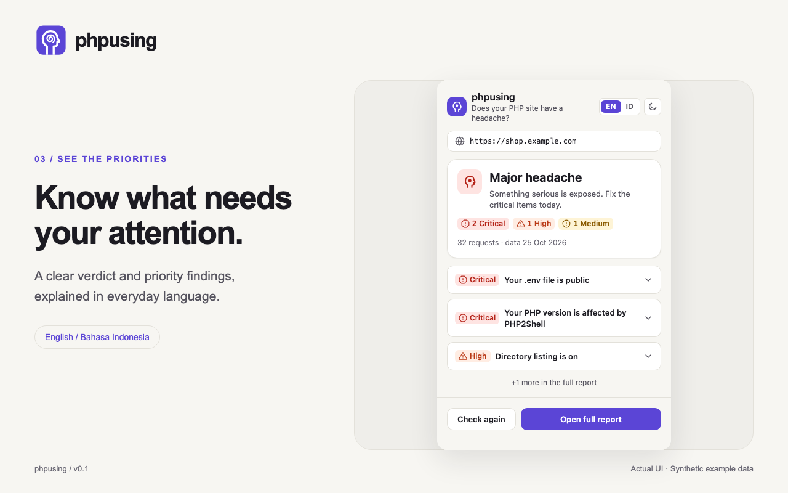
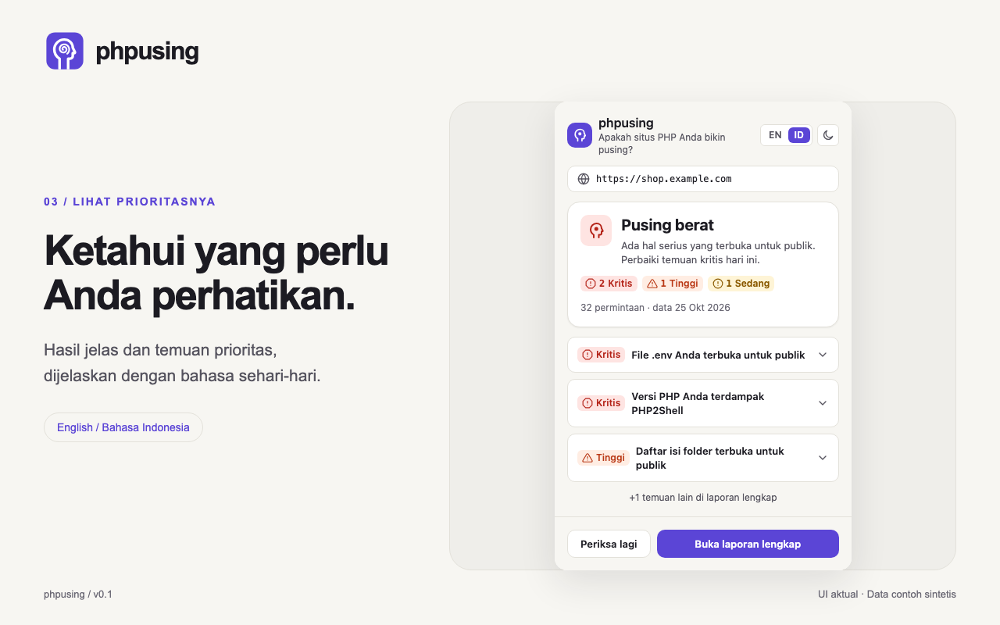

# phpusing


> Find the headache in your PHP site before an attacker does.

[](LICENSE)

**phpusing** is a local-first Chrome extension for PHP site owners. It checks the active site for high-impact, publicly observable security problems—such as exposed `.env` files, debug pages, risky development tools, and outdated PHP versions—then explains the result in plain English or Bahasa Indonesia.

It is detection tooling, not a vulnerability scanner or a guarantee of security. phpusing never claims a site is safe; at best, it reports that no critical issues were found in what it could see.

## Status

v0.1 is feature-complete and preparing for its first Chrome Web Store release. The extension is not published yet. The EN/ID marketing kit is ready; manual browser checks remain before release; see [project status](docs/00_STATUS.md).

## Product preview



<details>
<summary>Bahasa Indonesia</summary>


phpusing membantu pemilik situs PHP memeriksa file terbuka, konfigurasi berisiko, dan masalah versi PHP yang dikenal. Pemeriksaan berjalan di browser, dengan izin Anda, pada situs di tab aktif. Gratis, sumber terbuka, tanpa akun atau pelacakan.



Hasil tenang bukan jaminan keamanan. Periksa hanya situs milik Anda atau yang boleh Anda uji. Belum dipublikasikan di Chrome Web Store.

</details>

[Brand kit and asset guide](docs/marketing/README.md) · [EN/ID marketing copy](docs/marketing/COPY.md)

## What it checks today

- PHP version exposure, including the PHP2Shell fixes and end-of-life PHP branches.
- Exposed `.env`, `.git`, Composer files, Laravel logs, backups, database dumps, and `phpinfo()` pages.
- Public debug pages, directory listings, Telescope, Horizon, Adminer, phpMyAdmin, and the PHPUnit `eval-stdin.php` path.
- Plain-HTTP use on the site currently open in the browser.

The exact shipped checks, signatures, severities, and release scope live in the [checks catalog](docs/04_CHECKS.md). Composer package vulnerability matching is planned for v0.2; it is not part of v0.1.

## Privacy and safety model

- **Local-first:** scan logic and results stay in the browser. There is no backend, telemetry, analytics, or account.
- **One origin at a time:** a scan starts only when the user explicitly requests it from the active tab and grants that origin's runtime permission.
- **Read-only and bounded:** requests are GET or HEAD only, use no attack payloads, and are limited to 60 requests per scan.
- **Secrets stay secret:** values from discovered files are never displayed, stored, logged, or included in copied reports. Findings retain redacted evidence such as a path or key name only.
- **No crawling:** phpusing has no URL input, bulk scans, scheduled scans, login attempts, form submission, or exploitation behavior.

Only scan a site you own or are explicitly authorized to test. Read [Privacy](PRIVACY.md), [What We Never Do](WHAT_WE_NEVER_DO.md), and the [security and privacy engineering contract](docs/06_SECURITY_PRIVACY.md) for details.

## Development setup

### Prerequisites

- Node.js 22.22 or later
- pnpm 10.21 or later (Corepack is recommended)
- Google Chrome or another Chromium-based browser for local extension testing

### Run locally

```bash
git clone https://github.com/andynur/phpusing.git
cd phpusing
corepack enable pnpm
pnpm install
pnpm dev --browser chrome
```

`pnpm dev --browser chrome` starts WXT's development workflow and loads the extension into a Chrome development profile. Without `--browser`, `pnpm dev` starts the development server only. Use the popup on a local test site or a site you are authorized to assess.

### Validate and package

```bash
pnpm check       # lint, formatting, typecheck, unit tests, build, bundle URL audit
pnpm test        # unit tests only
pnpm build       # production extension build
pnpm zip         # Chrome Web Store upload archive
```

For a focused test while editing, run `pnpm vitest run tests/<file>.test.ts`. Full validation writes detailed logs to `.agent-logs/` when a step fails.

## Architecture

phpusing is a Manifest V3 extension built with WXT, React, TypeScript, Tailwind CSS, Vitest, and pnpm.

```text
Popup and report UI
        |
        v
Background service worker --> read-only probes to the active tab's origin
        |
        v
Pure check functions --> redacted findings --> session-only scan result
```

The extension uses `activeTab`, `scripting`, and `storage`, plus an optional host permission granted at runtime for the selected origin. It does not request broad host access, cookies, browsing history, web request interception, or tab enumeration. See the [architecture](docs/03_ARCHITECTURE.md) for the scan pipeline, permission rationale, and data boundaries.

## Repository guide

| Path | Purpose |
| --- | --- |
| `src/checks/` | Pure detection functions and redacted finding construction |
| `src/scanner/` | Request budget, baseline, fetch wrapper, and probe planning |
| `src/entrypoints/` | WXT background, popup, and report entrypoints |
| `src/shared/` | Types, i18n, verdict logic, and reusable UI |
| `tests/` | Unit tests and synthetic fixtures |
| `docs/` | Product, architecture, checks, privacy, decisions, and test plans |
| `data/snapshot/` | Bundled v0.1 advisory snapshot |

## Contributing

Contributions are welcome, especially careful check coverage, translations, tests, and documentation improvements.

1. Read [CONTRIBUTING.md](CONTRIBUTING.md), [AGENTS.md](AGENTS.md), and [What We Never Do](WHAT_WE_NEVER_DO.md).
2. Keep each change focused and use English for code, documentation, tests, and commit messages.
3. For a new check, first add its row to the [checks catalog](docs/04_CHECKS.md), then add implementation, synthetic positive and negative fixtures, and English/Indonesian strings.
4. Run `pnpm check` before opening a pull request.

Never commit real secrets, real production logs, private URLs, or fixtures copied from a live site.

## Security reporting

Please report vulnerabilities privately through [GitHub Security Advisories](https://github.com/andynur/phpusing/security/advisories/new), not through public issues. Include the affected version, reproduction steps, and impact. For false positives or missed findings, open a normal issue with the check ID and sanitized details. See [SECURITY.md](SECURITY.md).

## Documentation

- [Product requirements](docs/01_PRD.md)
- [Roadmap](docs/02_ROADMAP.md)
- [Checks catalog](docs/04_CHECKS.md)
- [Test plan](docs/08_TEST_PLAN.md)
- [Project decisions](docs/09_DECISIONS.md)
- [Changelog](CHANGELOG.md)

## License

phpusing is released under the [MIT License](LICENSE).
